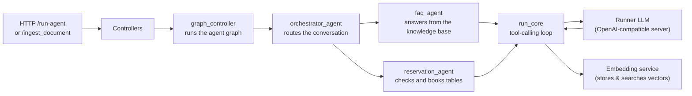

# Restaurant AI Agent

[](https://www.python.org/downloads/release/python-3120)
[](https://fastapi.tiangolo.dev/)
[](https://python.langchain.com/)
[](https://langchain-ai.github.io/langgraph/)
[](https://www.docker.com/)
[](https://www.postgresql.org/)

A restaurant customer-assistant service. It answers customer questions about
the restaurant (menu, opening hours, policies, …) and handles table
reservations, powered by FastAPI, LangGraph, LangChain, and a PostgreSQL
database with pgvector.

## ✨ Features

- 🧠 **Tool-calling agent** – a lightweight agent loop that lets the LLM decide
  when to call a tool, executes the requested calls, and feeds the results back
  until it produces a final answer.

- 📚 **RAG pipeline** – upload a PDF and its content is parsed, chunked,
  embedded, and stored, so the FAQ agent can answer from your own documents.

- 💬 **Two entry points** – a REST endpoint and a Telegram webhook hook, both
  backed by the same agent.

- 🗃️ **Versioned database** – tables are defined with SQLAlchemy and stored in
  a `pgvector`-enabled PostgreSQL database.

- 🔌 **Easy to extend** – tools are plain async functions decorated with
  `@tool`; adding one only requires registering it in the agent.

## 🧰 Built-in tools

| Tool | Used for |
| --- | --- |
| `search_menu_docs` | FAQ: hybrid (semantic + keyword) search over ingested documents |
| `search_available_tables` | Reservations: check which restaurant tables are available |
| `book_table` | Reservations: book a table for a given date |

## 🏗️ Architecture



Both chat entry points converge on the same graph runner, which binds the
available tools to the LLM and loops — invoking the model, dispatching any
requested tool calls, and feeding the results back — until the model returns a
final answer.

Ingesting a document converts it into chunks with embeddings that are stored
for retrieval, as described under [Testing](#testing).

## 🚀 Getting started

- **Environment** – Python 3.12 is used (see `Dockerfile`). A virtual environment
  is already provisioned in `.venv/`.

1. **Configure the environment** – copy `.env.example` to `.env` and fill in the
   values (see [Configuration](#configuration)). `config/settings.py` loads `.env`
   when the app starts.

   ```bash
   cp .env.example .env
   ```

2. **Run the app** – either locally:

   ```bash
   uvicorn main:app --host 0.0.0.0 --port 8001
   ```

   or with Docker Compose, which also starts a `postgres` container:

   ```bash
   docker compose up
   ```

3. **Talk to it** – the API is now running. See [API](#api).

## 🔗 API endpoints

| Method | Path | Description |
| ------ | ---- | ----------- |
| GET | `/health` | Health check. |
| POST | `/webhook` | Telegram webhook hook. Not implemented yet. |
| POST | `/run-agent` | Run the agent for a query and return the reply. |
| POST | `/ingest_document` | Upload a PDF to make its content searchable. |

`POST /run-agent` accepts a JSON body:

```json
{
  "query": "Do you have a table for 4 on Friday?",
  "session_id": "optional-session-id"
}
```

The optional `session_id` selects the conversation memory; otherwise a new id is
generated.

## 🧪 Testing

The evaluation script runs the agent end-to-end against the cases in
`evals/cases.json` and verifies the replies and the tools that were called:

```bash
docker compose exec app python -m evals.run_evals
```

## 🧩 Adding a new tool

1. Create `tools/<name>_tool.py`, write a function, and decorate it with `@tool`
   from `langchain_core.tools`. Give it a clear docstring — that is the only
   description the model sees.

2. Add any required credentials to `config/settings.py` and `.env.example`.

3. Import the tool and add it to the list passed into `run_core` in
   `agents/core.py`.

## 🗂️ Project structure

```text
.
├── main.py                        # FastAPI app and HTTP endpoints
├── requirements.txt              # Pinned dependencies for the app and services
├── Dockerfile                   # App image (python:3.12-slim); runs `uvicorn main:app`
├── docker-compose.yml           # `app` + `postgres` services
├── .env.example                 # Template for the required environment variables
├── .gitignore
├── agents/                     # LangGraph agent nodes
│   ├── core.py                # Shared LangChain agent loop (run_core)
│   ├── orchestrator_agent.py # Intent router for the conversation
│   ├── faq_agent.py         # Answers FAQ using the knowledge base
│   └── reservation_agent.py  # Handles reservations and bookings
├── config/                     # Configuration and prompts
│   ├── settings.py          # Environment variables
│   └── prompts.py          # All LLM prompts
├── controllers/               # HTTP-facing logic
│   ├── graph_controller.py   # Builds/caches the agent graph; runs it
│   └── ingest_controller.py  # PDF upload -> chunk -> embed -> store
├── database/                  # Async SQLAlchemy setup and ORM
│   ├── connection.py        # Async engine/session
│   └── models/              # Restaurant tables and ingested chunks
├── evals/                     # Evaluation cases and runner
│   ├── run_evals.py
│   └── cases.json
├── repository/               # Data-access layer
│   ├── chunk_repository.py  # Hybrid (semantic + keyword) search over chunks
│   └── table_repository.py # Restaurant table queries (availability, booking)
└── services/                # Business services
    ├── embedding_service.py      # Embeddings and query embeddings
    └── document_chunking_service.py  # Split uploaded PDFs into searchable chunks
```

## ⚙️ Configuration

All configuration is read from environment variables (see `.env.example`):

| Variable | Purpose |
| -------- | ------- |
| `TIMEZONE` | Timezone used when resolving dates in prompts. |
| `POSTGRES_HOST`, `POSTGRES_PORT`, `POSTGRES_USER`, `POSTGRES_PASSWORD`, `POSTGRES_DB` | PostgreSQL connection. |
| `RUNNER_MODEL_BASE_URL` | Base URL of the OpenAI-compatible model runner. |
| `RUNNER_MODEL` | Model used by the agents. |
| `RUNNER_EMBEDDING_MODEL` | Model used for embeddings. |
| `EMBEDDING_DIM` | Dimension of the embedding vectors. |
| `LANGSMITH_TRACING` | Enables LangSmith tracing, if desired. |
| `LANGSMITH_API_KEY`, `LANGSMITH_PROJECT`, `LANGSMITH_ENDPOINT` | LangSmith credentials and project. |
